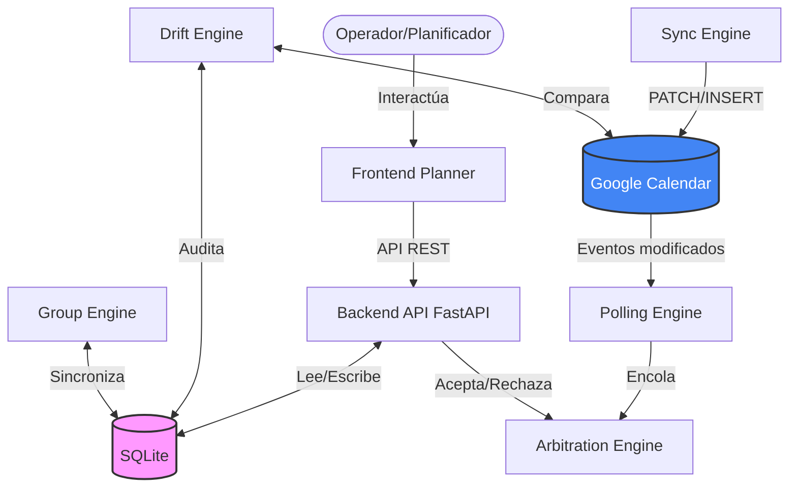
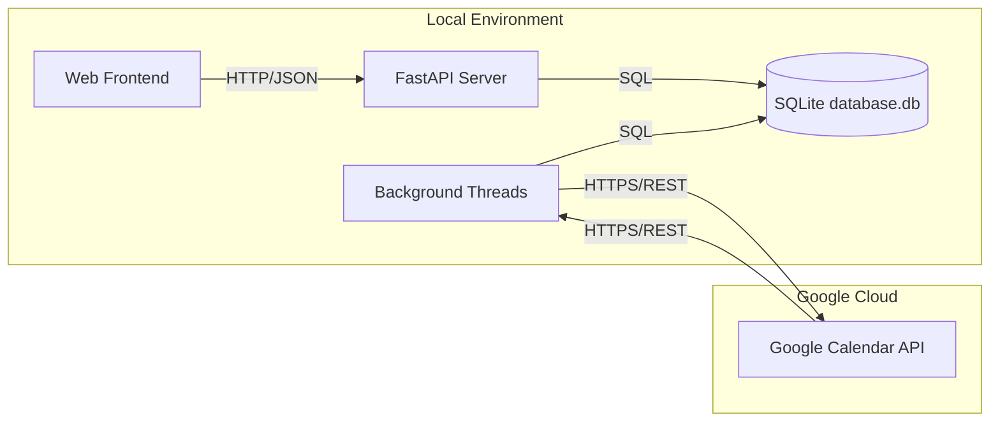
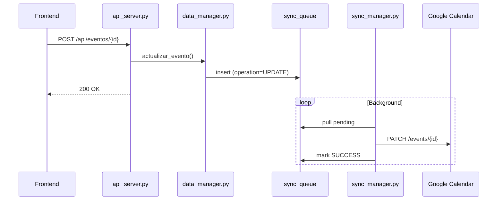
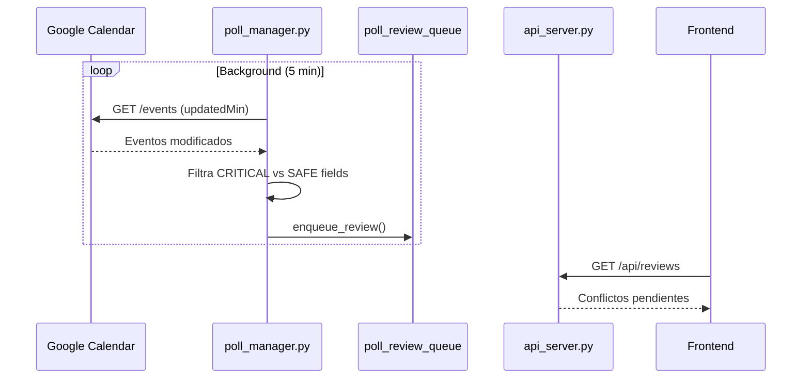
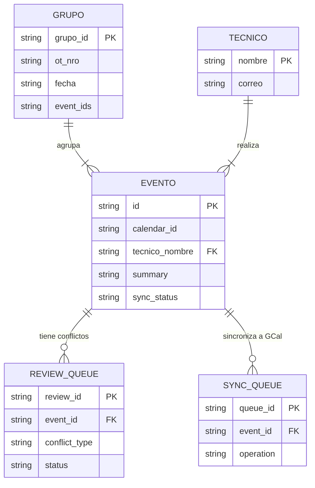

# AppPlanificacion — Documentación Arquitectónica y Funcional Completa

## Executive Summary
AppPlanificacion es un sistema de planificación de técnicos y órdenes de trabajo (OTs) altamente asincrónico y sincronizado bidireccionalmente con Google Calendar. Su núcleo reside en una arquitectura de "Single Source of Truth Flexible" basada en SQLite, donde los cambios locales tienen prioridad, pero los cambios remotos (Google Calendar) son detectados mediante un motor de Polling constante y arbitrados mediante un Inbox de revisiones (Review Queue).

El sistema cuenta con motores robustos para mantener la integridad de Grupos (múltiples técnicos en la misma OT/Fecha), sanación automática de desvíos (Drift Manager) y una estricta política de pertenencia de campos (Field Ownership).

---

## Índice Completo
1. [Nivel 0 — System Architecture & Context](#nivel-0--system-architecture--context)
2. [Nivel 1 — Domain Specification](#nivel-1--domain-specification)
3. [Nivel 2 — Data Model](#nivel-2--data-model)
4. [Nivel 3 — Lifecycle Documentation](#nivel-3--lifecycle-documentation)
5. [Nivel 4 — Operations Catalog](#nivel-4--operations-catalog)
6. [Nivel 5 — Engine Documentation](#nivel-5--engine-documentation)
7. [Nivel 6 — Drift Specification](#nivel-6--drift-specification)
8. [Nivel 7 — Architecture Decision Records (ADRs)](#nivel-7--architecture-decision-records-adrs)
9. [Nivel 8 — Runbook Operacional](#nivel-8--runbook-operacional)
10. [Nivel 9 — Observability & Diagnostics](#nivel-9--observability--diagnostics)
11. [Nivel 10 — Technical Debt Report](#nivel-10--technical-debt-report)
12. [Appendix — Referencias al Código](#appendix--referencias-al-código)

---

## Nivel 0 — System Architecture & Context

### 0.1 Context Diagram

**Evidencia:** 
- `api_server.py`: Define los endpoints HTTP.
- `sync_manager.py`: Módulo `SyncWorker` que envía hacia GCal.
- `poll_manager.py`: Módulo `PollingManager` que lee desde GCal.
- `drift_manager.py`: Auditoría periódica.

### 0.2 Container Diagram

**Evidencia:** `launcher.py` instancia `api_server` y los hilos en background (`run_sync_worker`, `run_poll_worker`).

### 0.3 High Level Data Flow

**Modificar Evento (Local a Remoto)**

**Detectar Cambio Externo (Remoto a Local)**

### 0.4 Source Of Truth Analysis
- **Eventos:** SQLite es la fuente primaria. Sin embargo, su estado final depende del Arbitraje si Google reporta un cambio concurrente.
- **Grupos:** SQLite (`grupos` table). Los grupos son un concepto puramente local; Google Calendar no tiene idea de qué es un "Grupo", solo ve eventos individuales.
- **Técnicos/OTs/Vehículos:** SQLite (`tecnicos`, `cache_ots`, `cache_vehiculos`).
- **Metadata (App_OTs, Grupo_ID):** Propiedad estricta de la aplicación local (`_PROTECTED_METADATA_KEYS` en `data_manager.py`).

**Conflictos Posibles:**
Race conditions entre el planificador (UI) modificando un evento y el técnico moviéndolo en Google Calendar. Se resuelven mediante **OCC (Optimistic Concurrency Control)** implementado en `accept_review` (`data_manager.py`).

---

## Nivel 1 — Domain Specification

### Entidades Funcionales
*   **Evento:** Unidad mínima de trabajo de un técnico.
*   **Grupo:** Agrupación lógica de eventos asociados a la misma OT y Fecha, asignados a múltiples técnicos.
*   **Técnico:** Persona con un calendario de Google asignado (`calendar_id`).
*   **Review:** Propuesta de cambio originada en Google Calendar que requiere arbitraje manual.
*   **Drift:** Inconsistencia detectada entre la base de datos local y Google Calendar (ej. Evento huérfano).
*   **Sync Job:** Tarea encolada para replicar una mutación local hacia Google Calendar.

### Domain Model Diagram

---

## Nivel 2 — Data Model

### Database Schema Diagram (SQLite)

**Tablas Principales:**
*   `eventos`: Almacena el estado de los eventos. (Source of Truth principal).
*   `grupos`: Estado de las agrupaciones.
*   `tecnicos`: Catálogo de técnicos y sus calendarios.
*   `sync_queue`: Cola de tareas outbound.
*   `poll_review_queue`: Cola de resolución inbound.
*   `drift_events`: Hallazgos del motor de auditoría.
*   `group_operation_journal`: Registro de mutaciones transaccionales en grupos.

**Invariantes y Relaciones Implícitas:**
- `eventos.tecnico_nombre` -> `tecnicos.nombre`.
- Un `evento` pertenece a un `grupo` si su ID está contenido en la lista CSV `grupos.event_ids` y sus metadatos (extended_props) contienen `grupo_id`.
- La tupla `(id, tecnico_nombre)` es Primary Key de la tabla `eventos`.

**Evidencia:** Extraído directamente del schema real de `planificacion.db`.

---

## Nivel 3 — Lifecycle Documentation

### 1. Crear Evento
**Trigger:** POST `/api/eventos`
**Call Stack:** `api_server.py` -> `db.crear_evento()` -> `insert eventos` -> `insert sync_queue (CREATE)`
**Side Effects:** El SyncWorker levanta el job y hace POST a la API de GCal.

### 4. Crear Grupo
**Trigger:** POST `/api/grupos`
**Call Stack:** `api_server.py` -> `group_operations.create_group()` -> Crea evento "Madre" -> Clona a los técnicos -> Escribe `group_operation_journal` -> Encola SYNC.
**Invariantes:** Todos los eventos del grupo deben tener la misma OT, fecha de inicio/fin y estar en calendarios distintos (Unique Ownership).

### 10. Polling Detect
**Trigger:** Hilo `run_poll_worker` en `launcher.py` (cada 5 minutos).
**Call Stack:** `poll_manager.py::_poll_calendar()` -> HTTP GET a GCal -> `_process_incoming_event()`.
**Mutaciones:** Si detecta cambio en campos críticos (hora, título), inserta en `poll_review_queue`. Si son cambios seguros (descripción), llama a `db.apply_poll_safe_changes()`.

### 11. Accept Review
**Trigger:** POST `/api/review/{review_id}/accept`
**Call Stack:** `api_server.py` -> `data_manager.py::accept_review()`.
**Mutaciones:** 
1. OCC Check: Valida que el evento no haya sido modificado desde que se detectó el review (`_version_at_detection`).
2. Metadata Shield: Rescata `grupo_id` y `app_ots` locales si Google los pisó.
3. Actualiza `eventos` y marca review como `RESOLVED`.
4. Si es `REMOTE_DELETE`, elimina o marca `CANCELLED_IN_GOOGLE`.

---

## Nivel 4 — Operations Catalog

| Operación | Endpoint | Motor | Entidades Afectadas | Side Effects | Invariantes |
| :--- | :--- | :--- | :--- | :--- | :--- |
| **Aceptar Review** | `POST /api/review/{id}/accept` | Arbitration | Eventos, Reviews | Mutación local forzada. Incrementa versión local. | OCC de 30s. Metadata Shielding. |
| **Crear Grupo** | `POST /api/grupos` | Group Engine | Grupos, Eventos, Sync | Creación de N eventos hijos con `grupo_id` sincronizado. | 1 técnico = 1 evento en el grupo. |
| **Editar Grupo** | `PUT /api/grupos/{id}` | Group Engine | Grupos, Eventos, Sync | Propagación a todos los miembros. | Realineación temporal usando mayoría (Majority Strategy). |
| **Drift Auto-Heal**| N/A (Background) | Drift / Group | Grupos, Journal | Limpieza de orphans, regeneración de sync jobs. | Solo aplica a `PARTIAL` > 2hs. |
| **Sync Update** | N/A (Background) | Sync Engine | GCal, Sync Queue | ETag Guard antes de PATCH a Google. | Google no debe tener versión más nueva. |

---

## Nivel 5 — Engine Documentation

### 5.1 Group Engine (`group_operations.py`, `group_repair.py`, `group_integrity.py`)
- **Responsabilidad:** Asegurar que los eventos que pertenecen a un grupo se muevan juntos y mantengan coherencia de metadatos.
- **Entradas:** Requests de creación/edición masiva desde el frontend.
- **Salidas:** Múltiples mutaciones en SQLite (`eventos`) y tareas en `sync_queue`.
- **Riesgos:** Fallos parciales donde un evento se actualiza y otro no (mitigado por el Journal y `auto_heal_partial_operations`).

### 5.2 Arbitration Engine (`data_manager.py::accept_review`)
- **Responsabilidad:** Resolver conflictos Last-Write-Wins entre Google y Planner.
- **Mecanismos Clave:** 
  1. `_PROTECTED_METADATA_KEYS` para evitar pérdida de metadatos de Planner.
  2. `OCC` (Control de concurrencia) para abortar si el humano acepta un review viejo.

### 5.3 Sync Engine (`sync_manager.py`)
- **Responsabilidad:** Propagar cambios de SQLite a Google.
- **ETag Guard:** Lee la fecha `updated` de Google. Si Google es más nuevo, aborta el push con `OUTBOUND_SKIPPED_STALE` para evitar pisar cambios.

### 5.4 Move Correlation Engine (`poll_manager.py`)
- **Responsabilidad:** Identificar cuándo un técnico mueve un evento entre calendarios.
- **Mecanismo:** Mantiene un buffer de 60s (`_move_buffer`). Si detecta un DELETE y un CREATE con el mismo título en ese lapso, los unifica en un review de tipo `REMOTE_CALENDAR_REASSIGNMENT`, conservando el ID local.

---

## Nivel 6 — Drift Specification

**Taxonomía Oficial de Drifts:**
1. **LOCAL_ORPHAN:** Existe en SQLite (`sync_status=SUCCESS`), pero Google lo eliminó o reporta 404.
2. **REMOTE_ORPHAN:** Existe en Google con origen Planner, pero no existe en SQLite.
3. **CALENDAR_MISMATCH:** El `tecnico_nombre` del evento en SQLite no concuerda con el `calendar_id` donde reside en Google.
4. **PROPERTY_MISMATCH:** Discrepancia en títulos, horas u otros campos que no fue resuelta por el Polling.
5. **GROUP_OWNERSHIP_DRIFT:** Un grupo tiene más de un evento asignado al mismo técnico.

**Detección y Reparación:**
- Detectado por `drift_manager.py` comparando un full-fetch de GCal contra SQLite.
- Volcado a la tabla `drift_events` y devuelto al Frontend en el Dashboard de Salud.

---

## Nivel 7 — Architecture Decision Records (ADRs)

### ADR-001: Evento como Source of Truth (con esteroides)
**Contexto:** Los eventos mutan localmente y en Google concurrente.
**Decisión:** SQLite es la fuente de verdad. Todo cambio remoto va a un Inbox (Arbitraje) en lugar de auto-aplicarse (excepto SAFE_FIELDS).
**Consecuencias:** Requiere intervención humana (Inbox), pero elimina la corrupción de datos generada por syncs ciegos.

### ADR-002: Metadatos "Blindados" (Metadata Shield)
**Contexto:** Aplicaciones móviles de terceros (ej. Google Calendar App) eliminan las `extendedProperties` al editar eventos.
**Decisión:** El backend fuerza la reinserción de claves como `grupo_id` y `app_ots` durante el Arbitraje (`accept_review`).
**Consecuencias:** GCal no puede destruir el modelo de datos relacional de la aplicación, incluso si el técnico borra los datos.

### ADR-003: Move Correlation Engine
**Contexto:** Cuando un técnico cambia de calendario un evento, GCal lanza DELETE y CREATE.
**Decisión:** Implementar un TTL de 60s en memoria (`_move_buffer`) en el Polling para atrapar la correlación y unificar la entidad.
**Consecuencias:** Se evita que un "Mover evento" resulte en la eliminación del ID de evento original y la creación de uno nuevo.

---

## Nivel 8 — Runbook Operacional

**Caso: Evento Trabado en "PROCESSING" o "REASSIGN_FAILED"**
- **Síntoma:** Evento no aparece en Google, `google_event_id` contiene texto literal en lugar de un hash.
- **Diagnóstico:** El worker falló en la etapa de reasignación y dejó campos de staging.
- **Reparación:** El sistema cuenta con reconciliación manual documentada (`scratch/_reconcile_check.py`) para resetear a `CANCELLED_IN_GOOGLE`.

**Caso: Conflicto "STALE_REVIEW"**
- **Síntoma:** El operador acepta un cambio del Inbox, pero la UI arroja HTTP 409 Conflict.
- **Diagnóstico:** El evento fue modificado localmente *después* de que el Polling leyó Google.
- **Reparación:** El operador debe rechazar el review o refrescar la página.

---

## Nivel 9 — Observability & Diagnostics

- **`poll_log` (BD):** Tabla central para traces del inbound. Registra `POLL_TRACE`, `DELETE_DETECTED`, `MANUAL_RECONCILIATION`.
- **`sync_log` (BD):** Tabla de auditoría para outbound (PATCH/INSERT a Google).
- **`group_operation_journal` (BD):** Bitácora transaccional para auditar qué pasó cuando un grupo falló parcialmente (Estado `PARTIAL`).
- **`server_err.log` y `error_log.txt`:** Logs flat en disco para errores fatales del event loop o FastAPI.

---

## Nivel 10 — Technical Debt Report

| Componente | Nivel de Deuda | Descripción | Riesgo |
| :--- | :--- | :--- | :--- |
| **Conexiones SQLite** | **HIGH** | Múltiples conexiones por hilo (`with db._get_connection()`). Dependencia excesiva del WAL mode. | Database Locks si aumenta el tráfico asincrónico. |
| **Polling Engine** | **MEDIUM** | Realiza `events().list()` iterativamente en 40+ calendarios. Operación bloqueante y muy intensiva en cuota de API. | Exceder cuota de GCal API si crecen los técnicos. (Mitigable usando Google Calendar Push Notifications). |
| **Group Integrity** | **LOW** | `group_integrity.py` implementa invariantes, pero la reparación es a demanda o auto-heal (max_age=2h), no transaccional inmediata. | Eventos temporalmente inconsistentes. |

---

## Appendix — Referencias al Código

- Arbitraje y Metadata Shield: `data_manager.py`, líneas 1200+ (`accept_review`).
- ETag Guard Outbound: `sync_manager.py`, líneas 370+ (`_do_update`).
- Move Correlation: `poll_manager.py`, líneas 35+ (`_MOVE_BUFFER_TTL_SECONDS`).
- Auto-Sanación de Grupos: `group_repair.py`, líneas 385+ (`auto_heal_partial_operations`).
- Reporte de Drift: `drift_manager.py`, líneas 200+ (`_run_drift_analysis_sync`).
