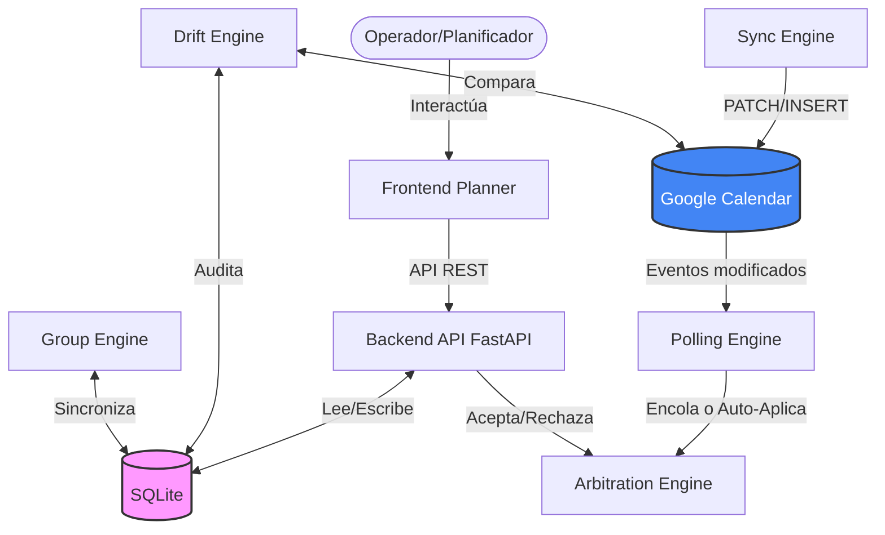

# AppPlanificacion — Documentación Arquitectónica y Funcional Completa

## Executive Summary
AppPlanificacion es un sistema de planificación de técnicos y órdenes de trabajo (OTs) altamente asincrónico y sincronizado bidireccionalmente con Google Calendar. Su núcleo reside en una arquitectura de "Single Source of Truth Flexible" basada en SQLite, donde los cambios locales tienen prioridad, pero los cambios remotos (Google Calendar) son detectados mediante un motor de Polling constante y arbitrados mediante un Inbox de revisiones (Review Queue). Este Inbox soporta auto-resolución (Auto-Apply) mediante reglas de enrutamiento configurables y resolución en cascada para eventos de cuadrilla (Sibling Reviews).

El sistema cuenta con motores robustos para mantener la integridad de Grupos (formación implícita e importación desde el exterior), normalización avanzada de zonas horarias para eventos complejos (`TimeNormalizationService`), sanación automática de desvíos (Drift Manager) y una estricta política de pertenencia de campos (Field Ownership).

---

## Índice Completo
1. [Nivel 0 — System Architecture & Context](#nivel-0--system-architecture--context)
2. [Nivel 1 — Domain Specification](#nivel-1--domain-specification)
3. [Nivel 2 — Data Model](#nivel-2--data-model)
4. [Nivel 3 — Lifecycle Documentation](#nivel-3--lifecycle-documentation)
5. [Nivel 4 — Operations Catalog](#nivel-4--operations-catalog)
6. [Nivel 5 — Engine Documentation](#nivel-5--engine-documentation)
7. [Nivel 6 — Drift Specification](#nivel-6--drift-specification)
8. [Nivel 7 — Architecture Decision Records (ADRs)](#nivel-7--architecture-decision-records-adrs)
9. [Nivel 8 — Runbook Operacional](#nivel-8--runbook-operacional)
10. [Nivel 9 — Observability & Diagnostics](#nivel-9--observability--diagnostics)
11. [Nivel 10 — Technical Debt Report](#nivel-10--technical-debt-report)
12. [Appendix — Referencias al Código](#appendix--referencias-al-código)

---

## Nivel 0 — System Architecture & Context

### 0.1 Context Diagram

**Evidencia:** 
- `api_server.py`: Define endpoints HTTP, cálculo de disponibilidad integrado (considerando eventos externos), y opera un *Watchdog* que permite la ejecución ininterrumpida en **Modo Servidor 24/7**.
- `sync_manager.py`: Módulo `SyncWorker` que envía hacia GCal.
- `poll_manager.py`: Motor inbound que aplica reglas (`poll_routing_config`) y gestiona caídas de red (fallback ante `HTTP 410 Gone`).
- `TimeNormalizationService`: Transforma y estandariza cálculos de fechas para eventos multidía entre el frontend y GCal.

### 0.2 Container Diagram
La arquitectura soporta lectura de identidad (`token.json` y perfiles de usuario) desde la raíz para autenticar sesiones del operador.

### 0.3 Source Of Truth Analysis
- **Eventos:** SQLite es la fuente primaria. Sin embargo, su estado final depende del Arbitraje si Google reporta un cambio concurrente.
- **Grupos:** SQLite (`grupos` table). Los grupos son un concepto puramente local. Si Google crea un evento (REMOTE_CREATE) con el mismo `google_event_id` de otro evento, se auto-forma un "Grupo Implícito". Adicionalmente, el sistema permite la **Importación de Eventos Externos**, desvinculando a los invitados de un organizador de Google y transformándolos en un Grupo nativo en SQLite.
- **Técnicos/OTs/Vehículos:** SQLite (`tecnicos`, `cache_ots`, `cache_vehiculos`).
- **Metadata:** Propiedad estricta de la aplicación local (`_PROTECTED_METADATA_KEYS`).

**Conflictos Posibles:**
Race conditions resueltas mediante **OCC (Optimistic Concurrency Control)**.

---

## Nivel 1 — Domain Specification

### Entidades Funcionales
*   **Evento (Simple o Multi-día):** Unidad de trabajo. Los eventos multi-día son procesados por el `TimeNormalizationService` para evitar discrepancias de huso horario o superposiciones.
*   **Grupo:** Agrupación lógica de eventos asociados a la misma OT y Fecha, asignados a múltiples técnicos. (Puede ser formal, implícito, o resultado de una importación externa).
*   **Técnico:** Persona con un calendario de Google asignado (`calendar_id`) y una especialidad/`servicio`.
*   **Review:** Propuesta de cambio originada en Google Calendar que requiere arbitraje.
*   **Drift:** Inconsistencia detectada entre la base de datos local y Google Calendar.

---

## Nivel 2 — Data Model

### Database Schema Diagram (SQLite)
**Tablas Principales:**
*   `eventos`: Almacena el estado de los eventos (Fuente de verdad).
*   `grupos`: Estado de las agrupaciones formales, implícitas y externas importadas.
*   `tecnicos`: Catálogo de técnicos y sus `servicios`.
*   `sync_queue`: Cola de tareas outbound.
*   `poll_review_queue`: Cola de resolución inbound con soporte de deduplicación.

---

## Nivel 3 — Lifecycle Documentation

### 10. Polling Detect & Inbound Routing
**Trigger:** Hilo `run_poll_worker` en `launcher.py`.
**Call Stack:** `poll_manager.py::_poll_calendar()` -> HTTP GET a GCal -> `_process_incoming_event()`.
**Mutaciones:** Dependiendo de `poll_routing_config`, el sistema encolará el cambio (INBOX) o aplicará la mutación automáticamente (AUTO_APPLY). El sistema es tolerante a borrados asincrónicos, ejecutando *fallbacks* ante errores `410 Gone`.

### 11. Accept Review & Auto-Resolución de Cuadrillas
**Trigger:** POST `/api/review/{review_id}/accept`
**Mutaciones:** 
1. Valida OCC (Control Optimista).
2. Rescata metadatos protegidos (Metadata Shield).
3. Actualiza `eventos` y marca review como `RESOLVED`.
4. **Sibling Review Auto-Resolution:** Si el evento es parte de un grupo, el sistema automáticamente rastrea y resuelve (acepta) de forma silente cualquier review idéntico pendiente en los demás integrantes de la cuadrilla, garantizando cohesión sin fatigar al operador.

---

## Nivel 4 — Operations Catalog

| Operación | Endpoint | Motor | Detalles Afectados |
| :--- | :--- | :--- | :--- |
| **Aceptar Review** | `POST /api/review/{id}/accept` | Arbitration | Mutación local forzada. **Auto-resuelve** conflictos de cuadrilla (Sibling Reviews). |
| **Importar Externo** | UI Popover -> Import | Data Manager | Clona evento remoto a SQLite, desvincula al creador y crea grupo nativo. |
| **Integrar Disponibilidad**| Búsqueda de Slots | API Server | Integra bloqueos de eventos *externos* para evitar conflictos de OT o Vehículo al sugerir huecos. |
| **Métricas de Ocupación** | `GET /api/indicadores/ocupacion` | API Server | Devuelve la ocupación consolidada por Servicio. |

---

## Nivel 5 — Engine Documentation

### 5.1 Group Engine (`group_operations.py`)
Asegura que los eventos que pertenecen a un grupo se muevan juntos. Incorpora ahora la lógica de importación, permitiendo capturar un evento creado fuera de AppPlanificacion, cortar el lazo con el organizador original de Google (invitees unlink) y gestionarlo internamente como cuadrilla.

### 5.2 Arbitration & Routing Engine (`poll_manager.py`, `data_manager.py`)
- **Auto-Resolución de Sibling Reviews:** Al arbitrar manualmente un evento de cuadrilla, el sistema deduce y acepta el mismo cambio para el resto del equipo simultáneamente.
- **Resiliencia 410:** El polling manager intercepta eventos eliminados crónicamente en GCal para evitar un loop de errores HTTP.

### 5.3 Time Normalization Service
- **Responsabilidad:** Asegurar la coherencia de fechas en eventos Multi-día. Calcula el rango de días efectivos e inyecta la normalización de fechas hacia la API de Google, previniendo bugs de renderizado de bloques visuales continuos en el *Frontend Scheduler*.

---

## Nivel 7 — Architecture Decision Records (ADRs)

### ADR-003: Inbound Routing & Sibling Auto-Resolve
**Decisión:** El arbitraje delega en el "Inbound Routing Engine" para auto-aplicar cambios seguros. A su vez, para mitigar la fatiga de decisión del usuario ante movimientos de un grupo entero desde el celular, la interfaz de Inbox consolida las aprobaciones mediante la auto-resolución de revisiones hermanas (Sibling Reviews).

### ADR-004: Importación Externa Activa
**Contexto:** Los usuarios solían agendar OTs directamente en Google Calendar. AppPlanificacion sufría bloqueos lógicos al intentar lidiar con organizadores externos.
**Decisión:** Se implementó una lógica de importación (External Event Import). El sistema copia el evento, elimina al organizador foráneo de la lista de invitados y lo trata como una creación local.

---

## Nivel 8 — Runbook Operacional

**Caso: Evento Trabado en "PROCESSING" o "REASSIGN_FAILED"**
- **Reparación:** Ejecutar el reconciliation manual (`scratch/_reconcile_check.py`) o forzar estado a `CANCELLED_IN_GOOGLE`.

**Caso: Falla de Sincronización HTTP 410**
- **Diagnóstico:** Un técnico borró un evento muy viejo de la papelera de Google Calendar y el Poll Manager intenta leerlo.
- **Reparación:** El sistema automáticamente descarta el marcador y genera un fallback de sync (implementado nativamente, no requiere acción manual).

---

## Nivel 10 — Technical Debt Report

| Componente | Nivel de Deuda | Descripción |
| :--- | :--- | :--- |
| **Conexiones SQLite** | **HIGH** | Múltiples conexiones por hilo (`with db._get_connection()`). Dependencia excesiva del WAL mode. |
| **Polling Engine** | **MEDIUM** | Realiza `events().list()` iterativamente en 40+ calendarios. Operación bloqueante (mitigable usando Webhooks). |
| **Group Integrity** | **LOW** | Reparación auto-heal asincrónica. Posible inconsistencia de milisegundos. |

---

## Appendix — Referencias al Código

- **TimeNormalizationService:** Lógica de abstracción temporal para frontend y API.
- **Importación y Availability Integration:** `api_server.py` (`_build_tech_events`).
- **Arbitraje, Sibling Reviews y Metadata Shield:** `data_manager.py` (`accept_review`).
- **Implicit Group Creation:** `data_manager.py` (vía `google_event_id`).
- **Resiliencia HTTP 410:** `poll_manager.py`.
