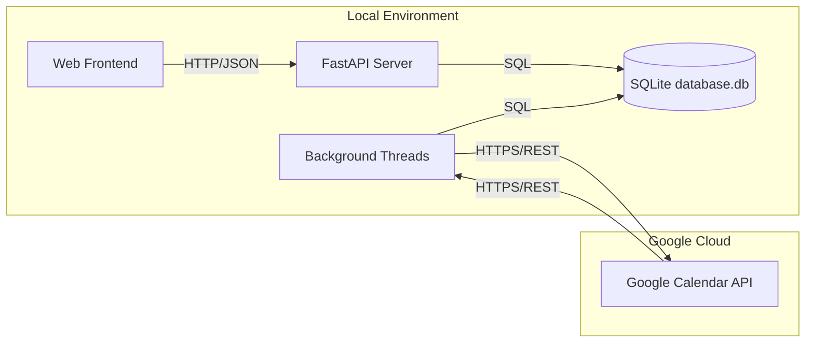
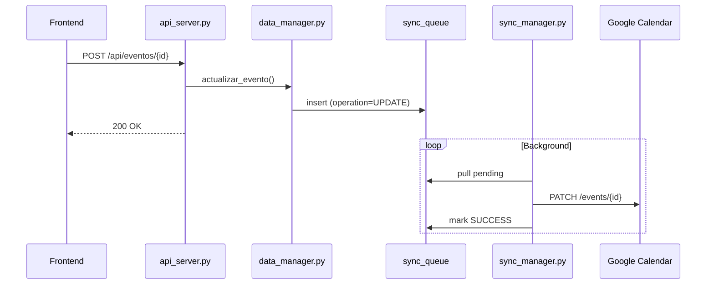
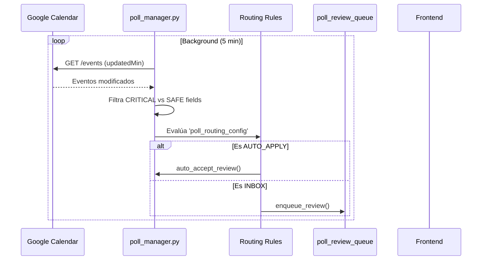

# AppPlanificacion — Documentación Arquitectónica y Funcional Completa

## Executive Summary
AppPlanificacion es un sistema de planificación de técnicos y órdenes de trabajo (OTs) altamente asincrónico y sincronizado bidireccionalmente con Google Calendar. Su núcleo reside en una arquitectura de "Single Source of Truth Flexible" basada en SQLite, donde los cambios locales tienen prioridad, pero los cambios remotos (Google Calendar) son detectados mediante un motor de Polling constante y arbitrados mediante un Inbox de revisiones (Review Queue), el cual soporta ahora auto-resolución (Auto-Apply) mediante reglas de enrutamiento configurables.

El sistema cuenta con motores robustos para mantener la integridad de Grupos (múltiples técnicos en la misma OT/Fecha, con formación implícita al vuelo), sanación automática de desvíos (Drift Manager) y una estricta política de pertenencia de campos (Field Ownership).

---

## Índice Completo
1. [Nivel 0 — System Architecture & Context](#nivel-0--system-architecture--context)
2. [Nivel 1 — Domain Specification](#nivel-1--domain-specification)
3. [Nivel 2 — Data Model](#nivel-2--data-model)
4. [Nivel 3 — Lifecycle Documentation](#nivel-3--lifecycle-documentation)
5. [Nivel 4 — Operations Catalog](#nivel-4--operations-catalog)
6. [Nivel 5 — Engine Documentation](#nivel-5--engine-documentation)
7. [Nivel 6 — Drift Specification](#nivel-6--drift-specification)
8. [Nivel 7 — Architecture Decision Records (ADRs)](#nivel-7--architecture-decision-records-adrs)
9. [Nivel 8 — Runbook Operacional](#nivel-8--runbook-operacional)
10. [Nivel 9 — Observability & Diagnostics](#nivel-9--observability--diagnostics)
11. [Nivel 10 — Technical Debt Report](#nivel-10--technical-debt-report)
12. [Appendix — Referencias al Código](#appendix--referencias-al-código)

---

## Nivel 0 — System Architecture & Context

### 0.1 Context Diagram

**Evidencia:** 
- `api_server.py`: Define los endpoints HTTP, incluyendo dashboards e indicadores (ej. `/api/indicadores/ocupacion`).
- `sync_manager.py`: Módulo `SyncWorker` que envía hacia GCal.
- `poll_manager.py`: Módulo `PollingManager` que lee desde GCal y aplica reglas de enrutamiento (`poll_routing_config`).
- `drift_manager.py`: Auditoría periódica.

### 0.2 Container Diagram

**Evidencia:** `launcher.py` instancia `api_server` y los hilos en background (`run_sync_worker`, `run_poll_worker`).

### 0.3 High Level Data Flow

**Modificar Evento (Local a Remoto)**

**Detectar Cambio Externo (Remoto a Local)**

### 0.4 Source Of Truth Analysis
- **Eventos:** SQLite es la fuente primaria. Sin embargo, su estado final depende del Arbitraje si Google reporta un cambio concurrente.
- **Grupos:** SQLite (`grupos` table). Los grupos son un concepto puramente local. Google Calendar no tiene idea de qué es un "Grupo", solo ve eventos individuales. Si Google crea un evento (REMOTE_CREATE) con el mismo `google_event_id` de otro evento existente, `data_manager.py` auto-forma un "Grupo Implícito" en SQLite para mantener la cohesión temporal.
- **Técnicos/OTs/Vehículos:** SQLite (`tecnicos`, `cache_ots`, `cache_vehiculos`). Incluye `servicio` por técnico.
- **Metadata (App_OTs, Grupo_ID):** Propiedad estricta de la aplicación local (`_PROTECTED_METADATA_KEYS` en `data_manager.py`).

**Conflictos Posibles:**
Race conditions entre el planificador modificando un evento y el técnico moviéndolo en GCal. Se resuelven mediante **OCC (Optimistic Concurrency Control)**.

---

## Nivel 1 — Domain Specification

### Entidades Funcionales
*   **Evento:** Unidad mínima de trabajo de un técnico.
*   **Grupo:** Agrupación lógica de eventos asociados a la misma OT y Fecha, asignados a múltiples técnicos. (Puede ser creado desde la UI o de forma implícita por el sistema inbound).
*   **Técnico:** Persona con un calendario de Google asignado (`calendar_id`) y una especialidad/`servicio`.
*   **Review:** Propuesta de cambio originada en Google Calendar que requiere arbitraje.
*   **Drift:** Inconsistencia detectada entre la base de datos local y Google Calendar.
*   **Sync Job:** Tarea encolada para replicar una mutación local hacia Google Calendar.

---

## Nivel 2 — Data Model

### Database Schema Diagram (SQLite)

**Tablas Principales:**
*   `eventos`: Almacena el estado de los eventos. (Source of Truth principal).
*   `grupos`: Estado de las agrupaciones formales e implícitas.
*   `tecnicos`: Catálogo de técnicos, correos y sus `servicios` (categoría operativa).
*   `sync_queue`: Cola de tareas outbound.
*   `poll_review_queue`: Cola de resolución inbound con soporte de deduplicación.
*   `drift_events`: Hallazgos del motor de auditoría.
*   `group_operation_journal`: Registro de mutaciones transaccionales en grupos.

**Evidencia:** `data_manager.py` (método `inicializar_db()`).

---

## Nivel 3 — Lifecycle Documentation

### 1. Crear Evento
**Trigger:** POST `/api/eventos`
**Call Stack:** `api_server.py` -> `db.crear_evento()` -> `insert eventos` -> `insert sync_queue (CREATE)`

### 4. Crear Grupo
**Trigger:** POST `/api/grupos`
**Call Stack:** `api_server.py` -> `group_operations.create_group()` -> Crea evento "Madre" -> Clona a los técnicos -> Escribe `group_operation_journal` -> Encola SYNC.

### 10. Polling Detect & Inbound Routing
**Trigger:** Hilo `run_poll_worker` en `launcher.py`.
**Call Stack:** `poll_manager.py::_poll_calendar()` -> HTTP GET a GCal -> `_process_incoming_event()`.
**Mutaciones:** Dependiendo de `poll_routing_config` (ej. "FIELD_CHANGE" = "AUTO_APPLY"), el sistema encolará el cambio para arbitraje manual o invocará automáticamente a `accept_review()`.

### 11. Accept Review (Arbitraje Automático o Manual)
**Trigger:** POST `/api/review/{review_id}/accept` o auto-apply desde el routing.
**Call Stack:** `api_server.py` -> `data_manager.py::accept_review()`.
**Mutaciones:** 
1. OCC Check: Valida que el evento no haya sido modificado desde la detección.
2. Metadata Shield: Rescata `grupo_id` y `app_ots` locales si Google los pisó.
3. Actualiza `eventos` y marca review como `RESOLVED`.
4. Si es `REMOTE_CREATE` y detecta un `google_event_id` compartido, dispara **Implicit Group Creation**.

---

## Nivel 4 — Operations Catalog

| Operación | Endpoint | Motor | Entidades Afectadas |
| :--- | :--- | :--- | :--- |
| **Aceptar Review** | `POST /api/review/{id}/accept` | Arbitration | Mutación local forzada con Metadata Shield y OCC. |
| **Implicit Group Creation** | N/A (Automático al crear) | Arbitration | Si entra un REMOTE_CREATE con un GID existente, se auto-crea un Grupo uniendo al nuevo técnico con el original. |
| **Crear/Editar Grupo** | `POST/PUT /api/grupos` | Group Engine | Propagación a todos los miembros y a `sync_queue`. |
| **Drift Auto-Heal**| N/A (Background) | Drift / Group | Limpieza de orphans, regeneración de sync jobs perdidos. |
| **Métricas de Ocupación** | `GET /api/indicadores/ocupacion` | API Server | Devuelve la ocupación consolidada por Servicio (disciplina técnica). |

---

## Nivel 5 — Engine Documentation

### 5.1 Group Engine (`group_operations.py`, `group_repair.py`, `group_integrity.py`)
- **Responsabilidad:** Asegurar que los eventos que pertenecen a un grupo se muevan juntos y mantengan coherencia de metadatos.
- **Riesgos:** Fallos parciales donde un evento se actualiza y otro no (mitigado por el Journal y `auto_heal_partial_operations`).

### 5.2 Arbitration & Routing Engine (`poll_manager.py`, `data_manager.py`)
- **Responsabilidad:** Resolver conflictos Last-Write-Wins entre Google y Planner.
- **Inbound Routing (`poll_routing_config`):** Define si un evento se va al Inbox (`INBOX`), se aplica automáticamente saltándose la cola de revisión humana (`AUTO_APPLY`) o se descarta (`IGNORE`).
- **Implicit Groups:** Capacidad del motor de arbitraje para detectar técnicos adicionales siendo invitados por GCal y agruparlos lógicamente bajo la misma OT.

### 5.3 Sync Engine (`sync_manager.py`)
- **Responsabilidad:** Propagar cambios de SQLite a Google.
- **ETag Guard:** Lee la fecha `updated` de Google. Si Google es más nuevo, aborta el push con `OUTBOUND_SKIPPED_STALE` para evitar pisar cambios.

---

## Nivel 6 — Drift Specification

**Taxonomía Oficial de Drifts:**
1. **LOCAL_ORPHAN:** Existe en SQLite (`sync_status=SUCCESS`), pero Google lo eliminó o reporta 404.
2. **REMOTE_ORPHAN:** Existe en Google con origen Planner, pero no existe en SQLite.
3. **CALENDAR_MISMATCH:** El `tecnico_nombre` del evento en SQLite no concuerda con el `calendar_id` de Google.
4. **PROPERTY_MISMATCH:** Discrepancia en títulos, horas u otros campos.
5. **GROUP_OWNERSHIP_DRIFT:** Un grupo tiene más de un evento asignado al mismo técnico.

---

## Nivel 7 — Architecture Decision Records (ADRs)

### ADR-001: Evento como Source of Truth (con esteroides)
**Contexto:** Los eventos mutan localmente y en Google concurrente.
**Decisión:** SQLite es la fuente de verdad. Todo cambio remoto es auditado por el Inbox de Arbitraje.

### ADR-002: Metadatos "Blindados" (Metadata Shield)
**Decisión:** El backend fuerza la reinserción de claves como `grupo_id` y `app_ots` durante el Arbitraje (`accept_review`) para evitar que GCal destruya el modelo de datos relacional de la app.

### ADR-003: Inbound Routing & Deprecación de Move Correlation [UPDATED]
**Contexto:** Originalmente, el Polling usaba un búfer de 60s en memoria (`Move Correlation`) para interceptar la eliminación y creación simultánea de eventos movidos entre calendarios. Esto era propenso a errores y race-conditions.
**Decisión:** Se eliminó el `_move_buffer`. En su lugar, el arbitraje ahora delega en el "Inbound Routing Engine" (`poll_routing_config`) que permite auto-aplicar cancelaciones (`REMOTE_DELETE`) o creaciones (`REMOTE_CREATE`), y al crear, agrupa automáticamente mediante "Implicit Groups" si un técnico fue movido de un calendario a otro compartiendo el mismo EventID.

---

## Nivel 8 — Runbook Operacional

**Caso: Evento Trabado en "PROCESSING" o "REASSIGN_FAILED"**
- **Diagnóstico:** El worker falló en la etapa de reasignación y dejó campos de staging.
- **Reparación:** Ejecutar el reconciliation manual (`scratch/_reconcile_check.py`) o forzar estado a `CANCELLED_IN_GOOGLE`.

**Caso: Conflicto "STALE_REVIEW"**
- **Síntoma:** El operador acepta un cambio del Inbox, pero la UI arroja HTTP 409 Conflict.
- **Diagnóstico:** El evento fue modificado localmente *después* de que el Polling leyó Google.
- **Reparación:** El operador debe rechazar el review (Ignorar) o refrescar la página, ya que la versión local pisó el conflicto original.

---

## Nivel 9 — Observability & Diagnostics

- **`poll_log` (BD):** Tabla central para traces del inbound. Registra `POLL_TRACE`, `DELETE_DETECTED`, `AUTO_APPLIED_DELETE`, `MANUAL_RECONCILIATION`.
- **`sync_log` (BD):** Tabla de auditoría para outbound (PATCH/INSERT a Google).
- **`group_operation_journal` (BD):** Bitácora transaccional para auditar grupos parcialmente sincronizados.

---

## Nivel 10 — Technical Debt Report

| Componente | Nivel de Deuda | Descripción | Riesgo |
| :--- | :--- | :--- | :--- |
| **Conexiones SQLite** | **HIGH** | Múltiples conexiones por hilo (`with db._get_connection()`). Dependencia excesiva del WAL mode. | Database Locks si aumenta el tráfico asincrónico. |
| **Polling Engine** | **MEDIUM** | Realiza `events().list()` iterativamente en 40+ calendarios. Operación bloqueante y muy intensiva en cuota de API. | Exceder cuota de GCal API si crecen los técnicos. (Mitigable usando Webhooks). |
| **Group Integrity** | **LOW** | `group_integrity.py` implementa invariantes, pero la reparación auto-heal es asincrónica. | Eventos temporalmente inconsistentes si se corta la conexión al sincronizar. |

---

## Appendix — Referencias al Código

- **Arbitraje y Metadata Shield:** `data_manager.py`, líneas 1200+ (`accept_review`).
- **Implicit Group Creation:** `data_manager.py` (dentro de `_handle_remote_create` vía lógica `google_event_id`).
- **ETag Guard Outbound:** `sync_manager.py`, líneas 370+ (`_do_update`).
- **Inbound Auto-Routing:** `poll_manager.py`, líneas 540+ y 760+ (`poll_routing_config` evaluate).
- **Métricas por Servicio:** `api_server.py`, endpoint `get_indicador_ocupacion`.
- **Auto-Sanación de Grupos:** `group_repair.py`, líneas 385+ (`auto_heal_partial_operations`).
- **Reporte de Drift:** `drift_manager.py`, líneas 200+ (`_run_drift_analysis_sync`).
