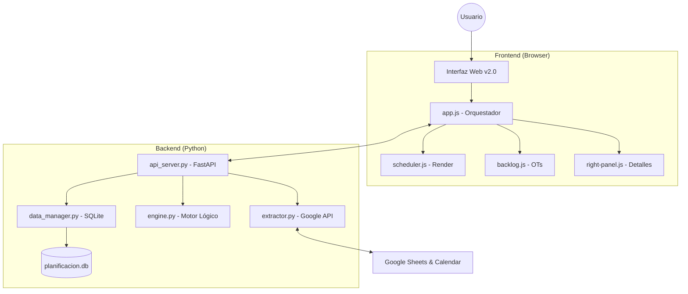

# Arquitectura Técnica — Akrimet Planner v2.0

Este documento detalla la estructura, componentes y flujo de datos del sistema de planificación de técnicos de Akrimet.

## 1. Visión General

El **Akrimet Planner** es una aplicación de escritorio híbrida (Python + Web) diseñada para gestionar la agenda de técnicos de campo, integrando datos de Google Sheets (OTs y Patrones) y Google Calendar (Agendas).

---

## 2. Componentes del Backend (Python)

### 2.1 Orquestador de Lanzamiento ([launcher.py](file:///c:/Users/ndiaz_akrimet/Git%20Proyect/AppPlanificacion/launcher.py))
- **Función**: Punto de entrada del programa.
- **Responsabilidades**:
    - Buscar un puerto libre dinámicamente.
    - Lanzar el servidor FastAPI en un hilo independiente.
    - Abrir el navegador en "Modo App" (Chrome) para una experiencia tipo escritorio.
    - Gestionar el ciclo de vida inicial de la aplicación.

### 2.2 Servidor API ([api_server.py](file:///c:/Users/ndiaz_akrimet/Git%20Proyect/AppPlanificacion/api_server.py))
- **Framework**: FastAPI (Uvicorn).
- **Responsabilidades**:
    - Definir endpoints REST para el frontend.
    - **Heartbeat Watchdog**: Implementa un hilo de monitoreo que apaga el servidor si detecta que la ventana del navegador se cerró (basado en falta de latidos de `app.js`).
    - Traducir peticiones complejas (búsqueda de disponibilidad) en llamadas al motor lógico.

### 2.3 Capa de Datos ([data_manager.py](file:///c:/Users/ndiaz_akrimet/Git%20Proyect/AppPlanificacion/data_manager.py))
- **Tecnología**: SQLite3.
- **Propósito**: Actuar como caché persistente y capa de abstracción.
- **Tablas Principales**: `tecnicos`, `eventos`, `cache_ots`, `cache_patrones`, `cache_vehiculos`.
- Permite que la aplicación funcione eficientemente sin consultar las APIs de Google en cada clic.

### 2.4 Integración con Google ([extractor.py](file:///c:/Users/ndiaz_akrimet/Git%20Proyect/AppPlanificacion/extractor.py))
- **Tecnología**: Google Discovery API.
- **Responsabilidades**:
    - Autenticación OAuth2 (gestionada via `token.json`).
    - Lectura de planillas maestras (OTs, Patrones, Vehículos).
    - Lectura/Escritura en calendarios de técnicos (Google Calendar).

### 2.5 Motor de Planificación ([engine.py](file:///c:/Users/ndiaz_akrimet/Git%20Proyect/AppPlanificacion/engine.py))
- **Lógica**: Algoritmos de búsqueda de slots libres.
- **Funciones Críticas**:
    - `buscar_disponibilidad`: Considera técnicos, duración, consecutividad y viajes.
    - **Validación de Patrones**: Detecta si un técnico está intentando usar un patrón que ya está asignado a otro técnico en la misma fecha (regla de coherencia).

---

## 3. Componentes del Frontend (Web)

### 3.1 Orquestador JS ([app.js](file:///c:/Users/ndiaz_akrimet/Git%20Proyect/AppPlanificacion/webapp/app.js))
- **Gestión de Estado**: Carga inicial de datos (`loadAll`) y sincronización.
- **Modales**: Control centralizado de ventanas emergentes (Patrones, Confirmación).
- **Heartbeat**: Envía un pulso al servidor cada 10 segundos para mantenerlo vivo.

### 3.2 Visualización ([scheduler.js](file:///c:/Users/ndiaz_akrimet/Git%20Proyect/AppPlanificacion/webapp/scheduler.js))
- **Vistas**: Soporta vista de "Planificador" (Eje X: Tiempo) y "Recursos" (Eje X: Calendario).
- **Alertas**: Renderiza iconos dinámicos para avisar sobre conflictos de patrones o falta de vehículos.

### 3.3 Gestión de OTs ([backlog.js](file:///c:/Users/ndiaz_akrimet/Git%20Proyect/AppPlanificacion/webapp/backlog.js))
- Administra el listado de OTs pendientes facilitando el arrastre (Drag & Drop) hacia el calendario.

### 3.4 Panel de Detalles ([right-panel.js](file:///c:/Users/ndiaz_akrimet/Git%20Proyect/AppPlanificacion/webapp/right-panel.js))
- Muestra información extendida de eventos.
- Permite la edición de recursos asignados a una OT ya programada.

---

## 4. Flujos de Datos Principales

### 4.1 Sincronización (Nube -> Local)
1. Usuario pulsa "Sincronizar".
2. `api_server` llama a `sync_cloud` en `extractor`.
3. `extractor` descarga OTs, Patrones y Eventos de Calendar.
4. `DataManager` vacía y repuebla las tablas de SQLite.
5. `app.js` refresca los componentes de la interfaz.

### 4.2 Programación Inteligente
1. El usuario selecciona OTs y patrones.
2. `app.js` envía parámetros a `/api/engine/buscar`.
3. `engine.py` cruza los calendarios locales y las reglas de patrones.
4. Retorna opciones recomendadas (Estrictas vs Flexibles).
5. Al confirmar, se envía la creación/actualización a `Google Calendar` y se actualiza la DB local.

---

## 5. Diseño y Estética ([style.css](file:///c:/Users/ndiaz_akrimet/Git%20Proyect/AppPlanificacion/webapp/style.css))

- **Modern UI**: Basado en colores oscuros (Dark Mode), degradados sutiles y tipografía clara.
- **Responsividad**: Uso intensivo de CSS Grid y Variables CSS para permitir re-dimensionamiento manual y fluido de los paneles laterales.
- **Micro-animaciones**: Transiciones suaves en modales, botones y tarjetas de OT.

---

> [!NOTE]
> Este diseño modular permite que la lógica de búsqueda de conflictos (`engine.py`) sea independiente de la persistencia de datos o de la interfaz, facilitando futuras actualizaciones de las reglas de negocio.
