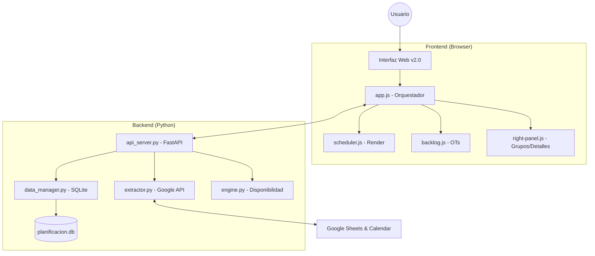

# Arquitectura Técnica — Akrimet Planner v2.0

Este documento detalla la estructura, componentes y flujo de datos del sistema de planificación de técnicos de Akrimet, optimizado para la gestión de grupos y sincronización de alto rendimiento.

## 1. Visión General

El **Akrimet Planner** es una aplicación de escritorio híbrida diseñada para gestionar la agenda de técnicos de campo. Integra datos de Google Sheets (OTs y Patrones) y Google Calendar (Agendas), utilizando una base de datos local para velocidad de respuesta inmediata.

---

## 2. Componentes del Backend (Python)

### 2.1 Orquestador y Lanzador ([launcher.py](file:///c:/Users/ndiaz_akrimet/Git%20Proyect/AppPlanificacion/launcher.py))
- **Smart Launch**: Busca puertos libres y espera activamente a que el servidor responda antes de abrir el navegador.
- **App Mode**: Abre Chrome/Edge sin barras de herramientas para una experiencia de escritorio "premium".
- **Robustez**: Redirección de logs a `error_log.txt` para diagnóstico en modo compilado.

### 2.2 Servidor API ([api_server.py](file:///c:/Users/ndiaz_akrimet/Git%20Proyect/AppPlanificacion/api_server.py))
- **FastAPI + Uvicorn**: Gestión asíncrona de peticiones.
- **Gestión de Grupos**: Endpoints para crear grupos, desasignar técnicos y sincronizar títulos con etiquetas de iniciales (ej: `OT 1234 - ND/LR`).
- **Heartbeat Watchdog**: Apaga automáticamente el servidor si detecta que la interfaz de usuario se cerró.

### 2.3 Capa de Datos y Grupos ([data_manager.py](file:///c:/Users/ndiaz_akrimet/Git%20Proyect/AppPlanificacion/data_manager.py))
- **SQLite3**: Persistencia local.
- **Tabla `grupos`**: Gestiona la relación lógica entre múltiples eventos de Calendar que pertenecen a una misma orden de trabajo y fecha.
- **Atomicidad**: Métodos para actualizar eventos individuales sin necesidad de refrescar toda la base de datos.

### 2.4 Integración y Seguridad ([extractor.py](file:///c:/Users/ndiaz_akrimet/Git%20Proyect/AppPlanificacion/extractor.py))
- **OAuth2**: Autenticación persistente via `token.json` (ubicado junto al ejecutable).
- **Bundling Paths**: Detección dinámica de rutas para funcionar correctamente tanto en desarrollo como dentro del binario compilado.

---

## 3. Estrategia de Sincronización Híbrida

Para garantizar fluidez, la aplicación utiliza tres niveles de sincronización:

1.  **Carga Rápida (Offline-First)**: Al abrir la app, los datos se cargan instantáneamente desde `planificacion.db`.
2.  **Sincronización de Fondo**: Un hilo asíncrono descarga cambios de Google Calendar en segundo plano.
3.  **Sincronización Focalizada**: Al crear, mover o editar un evento, solo se actualiza ese evento específico (o su grupo) en la memoria del frontend, evitando recargas completas (Refresh).

---

## 4. Gestión de Grupos de Trabajo

### 4.1 Ciclo de Vida del Grupo
1.  **Creación**: Desde el Backlog o agregando técnicos a un evento existente. Se asigna un `grupo_id`.
2.  **Identificación**: El sistema genera automáticamente el tag de iniciales (ej: `- ND/LR/JS`) y lo inyecta en el título del evento en todos los calendarios involucrados.
3.  **Desasignación**: Al quitar un técnico, el sistema borra su evento y regenera el tag de iniciales para los integrantes restantes de forma automática.

### 4.2 Tarjeta de Salida
Módulo que consolida la información de un grupo (técnicos, OTs, patrones y vehículos) en un formato imprimible, facilitando la logística diaria.

---

## 5. Compilación y Despliegue ([build_exe.py](file:///c:/Users/ndiaz_akrimet/Git%20Proyect/AppPlanificacion/build_exe.py))

- **PyInstaller**: Empaquetado en un solo archivo `.exe`.
- **Recursos Embebidos**: La carpeta `webapp` se incluye dentro del binario (`_MEIPASS`).
- **Configuración Externa**: `credentials.json` y `token.json` se mantienen fuera del `.exe` para permitir cambios de configuración sin re-compilar.

---

> [!IMPORTANT]
> **Consistencia de Datos**: Toda operación de escritura en Google Calendar debe tener su contraparte inmediata en la tabla `eventos` de SQLite para mantener la integridad visual del planificador.
